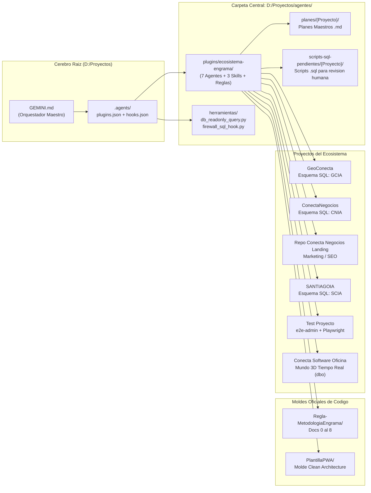

# Presentación de Arquitectura: Ecosistema de Agentes IA & Conecta Software Oficina

Documento ejecutivo para mostrar cómo opera la central de inteligencia en **`D:\Proyectos`**, cómo se relacionan todas las carpetas de **`agentes/`**, qué hace cada agente y cómo convive de forma **100% limpia** con el trabajo en Git del equipo.

---

## 1. Esquema General: Relación entre Carpetas, Reglas y Proyectos

1. **El Cerebro Central (`GEMINI.md` + `.agents/` + `agentes/`)** — Gobierna a la IA desde afuera sin ensuciar los commits de los repositorios.
2. **Los Moldes Oficiales (`Regla-MetodologiaEngrama/` + `PlantillaPWA/`)** — Fuente de verdad obligatoria antes de escribir una sola línea de código.
3. **Los Proyectos Productivos y QA** — Cada uno con su propio repositorio Git intacto y su esquema en SQL Server.

---

## 2. Catálogo del Escuadrón de Agentes IA

| Agente IA | Proyecto Asignado | Esquema BD (Read-Only) | Función Exacta |
| :--- | :--- | :---: | :--- |
| **`agente-estratega-ia`** | Transversal (Todos) | Todos | **Arquitecto Principal e Investigador UX/Producto.** Investiga y eleva cada idea a nivel empresarial antes de planear o programar. |
| **`agente-geoconecta`** | `GeoConecta` | `GCIA` | Rastreo GPS, `GeoConecta.Worker`, bitácoras, IA de flotillas y Multi-Tenant. |
| **`agente-conectanegocios`** | `ConectaNegocios` | `CNIA` | Solución .NET 9 multi-cliente (`API`, `Share`, `SharedUI`, `Admin`, `Client`, `Propietarios`, `Mobile`, `MAUI`). |
| **`agente-conectalanding`** | `Repo Conecta Negocios Landing` | Lectura `CNIA` | Marketing estático, conversión (CRO), SEO técnico y conexión con rutas de `ConectaNegocios`. |
| **`agente-santiagoia`** | `SANTIAGOIA` | `SCIA` | Trámites ciudadanos inteligentes, asistente IA, WhatsApp y scrapers. |
| **`agente-qa-e2e`** | `Test Proyecto` | Lectura validación | Panel Blazor `e2e-admin` y suites automatizadas Playwright (`PruebasE2E`). |
| **`agente-oficinaia`** | `Conecta Software Oficina` | `dbo` (`Ofia_*`) | Mundo Virtual 3D Isométrico en tiempo real, patrullaje autónomo, correos Brevo y despliegue Azure. |
