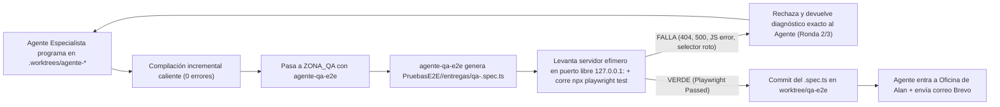

# PLAN MAESTRO — Filtro Obligatorio `agente-qa-e2e` con Creación y Ejecución Automática de Flujos Playwright

- **Proyecto:** `Conecta Software Oficina` (`OficinaIA`) + `Test Proyecto` (`PruebasE2E`) + `AgentesConecta`
- **Autor:** Cerebro Orquestador + `agente-estratega-ia` + `agente-qa-e2e`
- **Objetivo del Patrón (Alan):**
  Antes de que cualquier agente dé por terminada una tarea o notifique en la Oficina del Patrón / correo Brevo, **debe pasar obligatoriamente por `agente-qa-e2e`**, quien **crea un flujo `.spec.ts` en Playwright** dentro de su worktree permanente (`D:\Proyectos\.worktrees\agente-qa-e2e\PruebasE2E`), levanta efímeramente el cambio, ejecuta Playwright en navegador real (Chrome / Edge) y dictamina **APROBADO** o **RECHAZADO (regresar a corregir)**.

---

## 1. Flujo End-to-End en la Oficina 3D

---

## 2. Soluciones de Ingeniería Clave (`ejecutar_qa_playwright.py`)

1. **Puertos Libres Efímeros Cero-Colisión**:
   - Cada corrida QA reserva puertos libres dinámicos (`127.0.0.1:<apiPort>` y `127.0.0.1:<uiPort>`), levanta `dotnet run --no-build` (o `http.server` para estáticos) reusando los binarios ya compilados en el worktree del agente, y mata el árbol de procesos en `finally`.
2. **Proxy Inteligente API + Tolerancia a SQL Pendiente**:
   - El `.spec.ts` generado intercepta `**/api/**` para redirigir llamadas WASM al puerto efímero del `.API` y reprueba automáticamente si hay `404` (ruta `Post*` mal escrita) o `500` por excepción C#/DI, tolerando únicamente objetos SQL pendientes cuando el folio incluye script en `scripts-sql-pendientes/`.
3. **Cero Desperdicio de Tokens**:
   - `ejecutar_qa_playwright.py` inspecciona `git diff` + `docs/agentes/handoff-ui.md` para extraer rutas `@page`, encabezados, botones, `data-testid` y endpoints `[HttpPost("Post...")]` generando el `.spec.ts` sin quemar miles de tokens leyendo todo el repositorio.
   - `node_modules` se instala una sola vez dentro del worktree permanente `.worktrees\agente-qa-e2e\PruebasE2E` y usa el navegador Chrome/Edge ya instalado en Windows (`PLAYWRIGHT_CHANNEL`).
